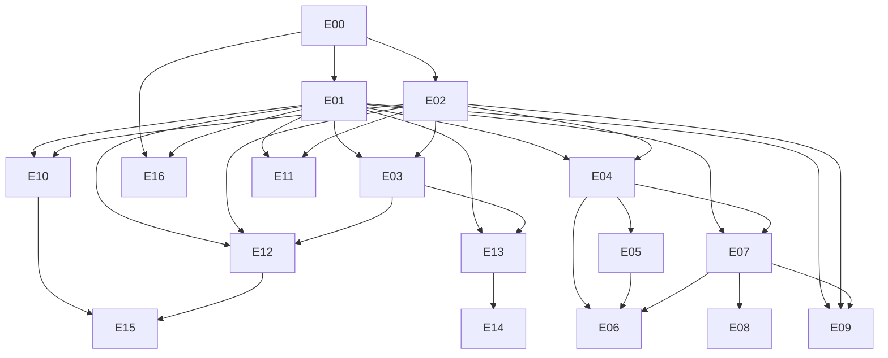

# START HERE — openGym Next v2 (instructions + plan in one file)

**Folder:** `C:\Users\soren\OneDrive\Desktop\openGym-Next-v2\`
- `START-HERE.md`: this file. Part A is instructions, Part B is the full v2 plan.
- `check_plan.py`: checks the plan's consistency.
- Original v1 (left as is): `C:\Users\soren\OneDrive\Desktop\openGym_Next_Complete_Build_Plan_Reconstructed.md`

The plan docs can stay in OneDrive. **The code repo must not** (see A2).

---

# Part A — Instructions

## A1. Verify the plan (30 s)
PowerShell:
```powershell
cd "$env:USERPROFILE\OneDrive\Desktop\openGym-Next-v2"
py check_plan.py START-HERE.md "..\openGym_Next_Complete_Build_Plan_Reconstructed.md"
```
Expected output ends with `RESULT: PASS`. Run it again after every edit to the plan's dependency YAML, mermaid graph or task list.

## A2. One-time environment (M0 prerequisite)
PowerShell as admin, once:
```powershell
wsl --install -d Ubuntu
```
Then do everything below in **Ubuntu (WSL)**:
```bash
sudo apt update && sudo apt install -y git build-essential python3
# Node: install nvm from github.com/nvm-sh/nvm, then after cloning use the repo's version:
#   nvm install   (reads .nvmrc)  — or the version in package.json "engines"
# Docker: Docker Desktop with WSL integration enabled for Ubuntu
mkdir -p ~/dev && cd ~/dev
git clone https://github.com/sorensadrgit-art/openGym.git
cd openGym
git remote add upstream https://github.com/DuarteSantos8/openGym.git
git fetch --all --prune
```
Repo path: `~/dev/openGym` in WSL. From Windows it's `\\wsl$\Ubuntu\home\<you>\dev\openGym`. It's outside OneDrive on purpose.

## A3. Pin the baseline (manual part of EP00-T01) — revised 2026-11-14
The first version of A3 assumed a clean fork (main ⊆ upstream). Your fork has shipped work (PRs #8 and #10 on main) and a diverged `next/integration`. This version checks the fork against reality instead.
```bash
cd ~/dev/openGym && git fetch --all --prune
git status --porcelain                                   # must print nothing
git log -1 --format='%H %cd' upstream/main               # record upstream SHA
# 1. Fork must CONTAIN upstream (being ahead is fine; missing upstream commits is not)
git merge-base --is-ancestor upstream/main origin/main && echo "OK: main contains upstream" || echo "BEHIND: merge upstream/main into main first"
# 2. Map every fork branch against main:  <branch>  <main-only>  <branch-only>
for b in $(git for-each-ref --format='%(refname:short)' refs/remotes/origin | grep -v -e HEAD -e '^origin$'); do
  printf '%-40s %s\n' "$b" "$(git rev-list --left-right --count origin/main...$b)"; done
# 3. Closed-unmerged PR heads must not be reachable from main
gh pr list --state closed --json number,mergedAt,headRefOid --jq '.[]|select(.mergedAt==null)|"\(.number) \(.headRefOid)"' |
  while read n oid; do git merge-base --is-ancestor "$oid" origin/main 2>/dev/null && echo "FAIL: closed PR #$n reached main"; done; echo "PR check done"
```
- Check 1 says BEHIND, or check 3 prints FAIL: stop and give the output to the A5 agent.
- Check 2 shows more than one branch with real work (branch-only > 0): **go to A3b before branching.**

## A3b. Choose the base (decision gate — yours, not an agent's)
Known state on 2026-11-14: `origin/main` 661d2c295 · `origin/next/integration` 225 ahead / 22 behind (EP-03/04/05a/05b) · Windows checkout `feat/nutritrace-diary-core` (local only; bundles backed up).
1. **Bring the local-only work into WSL as a local branch** so the inventory can see it. Nothing gets pushed:
   `git fetch /path/to/unpushed-commits.bundle 'refs/heads/*:refs/heads/salvage/*'`, then apply the patch and the untracked tarball on `salvage/feat-nutritrace-diary-core` and commit.
2. **Trial integration (throwaway):** `git worktree add ../trial origin/next/integration && cd ../trial && git merge origin/main`, then run every suite from the repo's package scripts plus the EP00 baseline journeys.
3. **Decide:**
   - **Base = next/integration** if the trial merges with only trivial conflicts, all suites are green, and flags-off parity holds (with modules off, the core workout journey is identical to main). EP03/04/05 then become *audit + harden* tasks, not rebuilds.
   - **Base = main** if the trial fails any of those. In that case, salvage EP-03/04/05 from next/integration one task group at a time, each in its own reviewed PR with tests (charter: no wholesale merges).
4. Record the choice in `docs/next/adr/0000-base-branch.md`. EP00-T03's inventory runs **on the chosen base**, and §9 dispositions are updated from it (work that already exists is marked present/partial).
Then:
```bash
git switch <chosen-base>
mkdir -p docs/next && cp "/mnt/c/Users/soren/OneDrive/Desktop/openGym-Next-v2/"* docs/next/
git worktree add ../openGym-EP00-T01 -b next/EP00-T01-baseline
```
Nothing gets pushed yet. Pushing and merging are always your call. An off-machine backup of the salvage branch (a private `backup/*` branch on origin) is recommended, but only once you approve it.

## A4. Per-task loop (every task group)
1. `git fetch upstream && git merge upstream/main` on your **chosen base from A3b** (plan §3.3). Then run CI or tests. Wherever this file says `main`, read it as that base.
2. `git worktree add ../openGym-EPxx-Tyy -b next/EPxx-Tyy-<slug>`
3. Paste the A5 prompt into a coding-agent session started in that worktree, with the task ID filled in.
4. Open a **fresh** agent session for review. Give it only the contract, the diff (`git diff main...HEAD`) and the test output, using the A6 prompt.
5. You check the tier evidence (plan §7). Then you merge, or mark the task `blocked`.
6. `git worktree remove ../openGym-EPxx-Tyy` after merge.
Limits: no more than 2 worktrees active at once. Tasks sized L get split before they start. SPIKE tasks get 1 session.

## A5. Coder prompt (paste, replace `EPxx-Tyy`)
```text
Repo: this worktree. Plan: docs/next/START-HERE.md.
Read ONLY: Part B sections 1–8, and the EPxx block in section 9.
Execute task EPxx-Tyy exactly per its type (BUILD/UI/SPIKE), tier and size in plan §7/§9.
Before coding: confirm the task's dependencies in deps.yaml are merged; list upstream files you will touch (plan §3.2).
Rules: no push, no merge, no deploy, no secrets, no restyling/reformatting upstream files, no new dependency without the §7 licence checklist.
BUILD/UI: show the RED failure first, then GREEN, then run the full existing test suites.
SPIKE: stay within the timebox, write docs/next/adr/NNNN-*.md using the §7 ADR template, no code to main.
Finish by returning the §7 handoff YAML filled with real commands and exit codes. Mark anything unverified as unverified.
```

## A6. Reviewer prompt (fresh session)
```text
You are an independent reviewer. Inputs: the task block EPxx-Tyy from docs/next/START-HERE.md §9, the §7 tier rules, the diff, and the test output below.
Try to break it: missing tier evidence, flags-off parity, sync/migration risk, secrets, licence, upstream files touched beyond §3.2.
Output: PASS or BLOCK, a numbered list of defects with file:line, and a list of claims you could not verify.
```

## A7. First 5 tasks, in order (M0)
`EP00-T01` → `EP00-T02` → `EP00-T03` (this produces the upstream inventory; update §9 dispositions afterwards) → `EP00-T04` → `EP01-T01` (the storage ADR, which blocks all nutrition code).

---

# Part B — Plan v2

# openGym Next — Build Plan v2 (engineering review applied)

> Revision of `openGym_Next_Complete_Build_Plan_Reconstructed.md` (2026-11-14). v1 is still the detailed reference for task wording. **This file overrides v1** on scope, sequence, dependencies, task types, roles and Definition of Done. Every one of v1's 66 task IDs is listed in §9 with what happens to it.
> Upstream facts below come from the upstream README as of 2026-11-14 and are **not yet code-verified**. EP00-T03 confirms them at the pinned SHA, and that inventory overrides this file.

---

## 0. Review findings (ranked)

| # | Sev | Weakness in v1 | Fix in v2 |
|---|---|---|---|
| F1 | High | **Scope duplicates upstream.** Per the upstream README, upstream already ships: e1RM curves, Structural Balance ratios, a year activity heatmap, a muscle map (volume/recovering/untrained), a body-weight chart, progress photos, Strong/Hevy/FitNotes importers, Apple Health/Health Connect (heart rate per set back in), Apple Watch, Wear OS beta, an AI coach with Anthropic/OpenAI/Gemini/any OpenAI-compatible endpoint **including Ollama**, and an MCP server. v1 still gives full epics to EP03, EP07, EP11, EP13 and EP14. | §2 overlap table. Those epics shrink to an audit plus a delta. Of v1's 66 groups, 15 are cut or made conditional (see §9). |
| F2 | High | **No plan for maintaining the fork.** Upstream is active (App Store, Watch). v1 front-loads a "premium" restyle of upstream screens (EP02-T02/T03) and polish of the core train view. Those are the files most likely to conflict on every upstream merge. | §3 fork strategy: feature folders, a limit on how much core files are touched, an upstream sync cadence, an upstream-first option. Restyling upstream screens moves to M2, screen by screen. |
| F3 | High | **Nutrition storage never examined.** User state is per-profile JSON with revision/409 sync. A diary grows without limit (~10 entries/day × ~300 B ≈ **~1.1 MB/yr/profile**). If the sync unit is the whole profile document, diary edits also collide with workout edits from another device. | The EP01-T01 exit now requires a **storage/sync ADR** (§5) before any EP04 code. |
| F4 | High | **MVP has no clear exit, and the gating is circular.** MVP = W0+W1, meaning all of EP00–EP06 (28 groups), plus "release candidate only after EP16", and EP16 depends on EP00–EP15. | §8: the MVP becomes milestone M1 with a fixed exit test and a release gate scoped to the milestone, **EP16-lite**. EP06 leaves the MVP. |
| F5 | Med | **A manual-only diary is tedious.** Typing macros for every food kills adoption. Food search is pushed back to EP05. | M1 also includes EP05-T01 **text search** (Open Food Facts), plus an optional bundled generic food table (§9 EP04). Barcode stays in M2. |
| F6 | Med | **One template for every task.** 64 identical "write failing test → implement code" lines, applied even to research tasks (EP00-T01, EP05-T03, EP09-T01, EP11-T01, EP12-T01, EP13-T01, EP14-T01, EP15-T01). No timeboxes, so research sprawls. | §7 has three task types: **BUILD** (TDD), **UI** (red Playwright/snapshot first), **SPIKE** (timeboxed; output is an ADR and no code reaches main). |
| F7 | Med | **Roles assume a team** (QA, DevOps, 3D designer, licence reviewer, clinical reviewer). "Independent review" is never defined. Delivery depends on Hermes/Qwen/Droid with no fallback. | §6 maps each role to a real actor, defines independence, and gives a single-session fallback. |
| F8 | Med | **The dependency graph contradicts the table.** The mermaid graph is missing hard edges: EP03←EP02, EP04←EP02, EP06←EP05, EP07←EP04, EP09←EP02/EP07, EP10←EP01, EP11←EP02, EP12←EP01, EP13←EP03, EP14←EP01. An agent that follows the graph starts work too early. | §8: a single YAML is the source of truth, the mermaid is derived from it, and a script checks consistency (§11). |
| F9 | Med | **No size or overrun signal.** "No calendar estimates" leaves no way to notice that work is stalling. | Each group gets a size (S/M/L, measured in agent sessions), WIP ≤ 2, and a rule that L tasks must be split before they start. |
| F10 | Med | **Dev environment risks.** The workspace path is on Windows, this plan sits in OneDrive, and command sets are mixed. iOS device tests need macOS + Xcode. | §4: repo outside OneDrive, WSL2 or devcontainer to match Linux CI, pinned Node, and iOS explicitly scoped by hardware. |
| F11 | Low | **Speculative items inside epics.** NutriTrace is unidentified (it's in an epic title). Node-RED and LangGraph.js are in plan before any need is shown (YAGNI). | NutriTrace becomes a SPIKE only. Node-RED and LangGraph move to the Ideas backlog (§10). |
| F12 | Low | **Clinical sign-off for EP15 is undefined.** A DPT student can't be the clinical approver. | EP15 requires a named licensed PT reviewer (for example faculty), or the epic stays disabled. |
| F13 | Low | **Document bloat.** The disclaimer repeats 26×, there are 64 identical delivery and handoff lines and 17 identical gates, ~142k chars in total (≈35k tokens loaded by every agent). | Boilerplate appears once (§7). Agents load §1–§8 plus their own epic only. |
| F14 | Low | **Same evidence burden for every task** (all viewports, screenshots, device logs). | Evidence is tiered by risk (§7, tiers A/B/C). |

**Kept from v1 (strengths):** don't harm the core workout path; flags off = identical app; parse→preview→apply with no mutation before approval; unknown nutrients ≠ 0; provenance on every external record; no auto-merge or auto-deploy; reconcile against upstream before each epic; camera frames ephemeral; AI proposals go through preview and approval.

---

## 1. Charter (condensed — unchanged intent)

Mission: extend the fork of `DuarteSantos8/openGym` (AGPL-3.0) into a self-hostable, local-first training + nutrition app with optional modules. Do not replace the core and do not bulk-merge other repos.

- Fork: `https://github.com/sorensadrgit-art/openGym` · Upstream: `https://github.com/DuarteSantos8/openGym`
- Historical baseline `68dad18f` and branch `feat/soren-addons-foundation-20261113` are **reference only**. Re-pin in EP00-T01.

Non-negotiables (v1 §00, kept): (1) no harm to the core workout path; (2) local-first, no mandatory cloud or telemetry, modules opt-in; (3) no secrets in bundles, exports, logs or Git; (4) no destructive sync, versioned migrations, backups; (5) a11y + perf are features; (6) respect AGPL and upstream media terms; (7) movement/rehab output is educational, not diagnostic; (8) small reviewed vertical slices, user approves every merge and deploy.

Out of scope unless approved: backend replacement, a mandatory managed DB, an auth/sync redesign, automatic prescription or diagnosis, unbounded agents, auto-merge/deploy, wholesale imports of external projects.

---

## 2. Upstream overlap (verify in EP00-T03 → `docs/next/UPSTREAM-INVENTORY.md`)

| Capability | Upstream README (2026-11-14) | v1 epic | v2 action |
|---|---|---|---|
| e1RM, Structural Balance, heatmap, body-weight chart, % of BW, lifetime total | present | EP03-T01/T02 | **Delta only:** drill-down from a trend to its sets, if missing; combined training + nutrition day view |
| Muscle map (volume / recovering / untrained) | present | EP03-T03, EP12-T03 | **Cut EP03-T03.** EP12 reuses upstream muscle data |
| Strong / Hevy / FitNotes import, Apple Health weight import | present | EP07-T01/T02/T03 | Audit. Build the shared preview/apply pipeline **only if** upstream lacks preview; needed by M3 connectors |
| Apple Health / Health Connect, HR per set, Apple Watch, Wear OS | present | EP11 | **Reduce to a SPIKE.** Direct BLE only for a proven gap |
| AI coach, multi-provider incl. Ollama / OpenAI-compatible | present | EP13, EP14-T01/T02 | Audit plus gaps. **Cut EP14-T02** unless the audit finds a gap |
| MCP server | present | — | Reuse; no new work |
| Nutrition diary / food search / barcode | not mentioned | EP04, EP05 | **Core new value. Build.** |
| Advanced programs (percent/TM cycles) | not mentioned | EP09 | Build in M3 after a SPIKE |
| Pose / movement lab | not mentioned | EP10 | Build in M4 |
| 3D anatomy | not mentioned (2D map exists) | EP12 | Build in M4 as an enhancement of the 2D map |

Before EP04, check upstream issues, discussions and roadmap for nutrition. If the maintainer plans it, coordinate (§3) instead of forking divergent schemas.

---

## 3. Fork strategy (new)

1. **Additive layout.** New code goes in feature folders (proposed `frontend/src/features/<module>/`, `api/features/<module>/`; follow upstream convention if it differs). Each module registers itself in **one** registry file (routes, nav entry, settings panel, flag, lazy import).
2. **Limit on core touches.** `docs/next/TOUCHPOINTS.md` lists every upstream file you modify, with the reason. Rules: no reformatting or restyling of upstream files inside a feature PR; changes to store, sync, auth or the train view are Tier A (§7); aim for ≤ ~30 changed lines per upstream file per PR. Larger changes need a design note first.
3. **Sync cadence.** Merge `upstream/main` into fork `main` at the **start of every task group** (and at least weekly), with CI on the merge commit. Never let the fork drift more than one task group behind.
4. **Upstream-first.** Generic bug fixes, a11y fixes and test improvements go upstream as small PRs. That shrinks the diff you carry. Ask the maintainer once whether a nutrition module would be accepted upstream; if yes, design the schema to their conventions.
5. **Branches.** `next/EPxx-Tyy-<slug>` from fork `main` in a new worktree. One PR per group.

---

## 4. Environment (new — removes most setup obstacles)

- Keep the repo **outside OneDrive** (OneDrive syncs `node_modules` and locks files, causing EBUSY/EPERM errors and slow installs). Example: `C:\dev\openGym` or WSL `~/dev/openGym`.
- Use **WSL2 Ubuntu or a devcontainer** that matches CI (Linux). Write one set of commands, Linux-only. Windows-native commands are only documented if they're actually needed.
- Pin Node using upstream `engines` / `.nvmrc` (v1 preferred Node 22; upstream wins). `npm ci` only.
- Docker Compose for the full stack; `.env.example` holds no secrets.
- **Mobile scope by hardware:** Android = emulator + one real phone. iOS needs macOS + Xcode. With no Mac, iOS is "no local claims, rely on upstream CI/TestFlight", and v2 tasks don't require iOS evidence.
- First EP00 output: `scripts/dev-check.sh` (Node version, Docker, ports, env file, and that `npm ci` and tests run). It must exit non-zero with an actionable message.

---

## 5. Storage / sync decision gate (new, inside EP01-T01)

Before any nutrition code, answer these and record them in `docs/next/adr/0001-nutrition-storage.md`:

1. Is the sync unit the **whole profile document** or a namespace/field? How does the 409 merge resolve concurrent edits to different namespaces?
2. Current size of a typical profile JSON, and how write and parse time scale with it (measure at 1×, 10× and 50× synthetic history).
3. Diary growth estimate (≈1.1 MB/yr at 10 entries/day; verify the entry size against the schema).
4. Decide between: (a) a namespace inside the profile; (b) a separate per-profile nutrition document with its own revision; (c) per-day or per-month documents. **Default recommendation: (b) or (c)** if the sync unit is the whole document, so diary edits can't conflict with workouts.
5. Native mirroring and export implications.

Exit: the ADR is accepted, and a fixture shows that a concurrent diary edit plus workout edit on two clients leaves no conflict lost.

---

## 6. Roles → real actors (replaces v1 §05 roles)

| Role | Actor | Rule |
|---|---|---|
| Orchestrator / final reviewer | Soren (Hermes assists if it's online) | Only Soren approves merges and deploys |
| Coder | One coding-agent session per worktree (Claude Code / Codex / Qwen / Droid, whichever is available). **Max 2 at once**, on non-overlapping paths | Agent self-reports are not evidence |
| Independent reviewer | A **fresh** agent session given only the contract, the diff and the test output, with no implementation chat history | Must try to break the change and list unverified claims |
| QA | The same fresh-session reviewer, plus Soren's manual journey for Tier A | — |
| Licence review | Soren, using the checklist in §7 | If unclear, don't ship the asset or dependency |
| Clinical review (EP15 only) | A **named licensed PT** | Without one, EP15 stays disabled |

**Fallback:** if multi-agent infra is down, run the same flow in one session (superpowers: brainstorming → writing-plans → TDD → verification-before-completion → requesting-code-review). The plan never blocks on agent infrastructure.

---

## 7. Task types, Definition of Done, evidence tiers (boilerplate appears once)

**Task types**
- **BUILD** (pure logic, API, data): red unit/API test first → minimal implementation → refactor → verify.
- **UI**: a red Playwright journey or visual snapshot first (at 390 and 1440 px), then implementation. No TDD theatre for token values. Contrast checks are automated.
- **SPIKE** (research, licence, API discovery, feasibility): **timebox of 1 session** (2 max, with a stated reason). Output: an ADR (template below) whose decision is go / no-go / go-with-constraints. Prototype code stays on a `spike/` branch and never merges.

**Evidence tiers**
- **Tier A**: touches store, sync, migrations, auth, export or the core workout path. Required: red→green, migration and legacy-read fixtures, two-client sync test, the EP00 baseline suite green, an independent review, and Soren's manual journey on phone and desktop.
- **Tier B**: new module behind a flag. Required: unit/component tests, one Playwright journey, screenshots at 390 and 1440, a **flags-off parity check**, and an independent review.
- **Tier C**: SPIKE or docs. Required: the ADR plus sources; no merge to main except the docs.

**Size:** S = ≤1 agent session · M = 2–4 · L = 5+. **L must be split before it starts.** WIP ≤ 2 groups.

**Done means:** the evidence for its tier is attached, CI is green, the baseline suite is green, the touchpoints file is updated, the docs are updated, and Soren has approved the merge. If any of that is missing, the status is `blocked` with the reason.

**Handoff (tier-aware)**
```yaml
task: EPxx-Tyy
type: BUILD|UI|SPIKE
tier: A|B|C
size: S|M|L
base_sha: <full>
branch: next/EPxx-Tyy-slug
upstream_merged_at_start: <sha>
touchpoints: []          # upstream files modified
red: {cmd: '', failing_assertion: ''}
green: [{cmd: '', exit: 0}]
journey_evidence: []     # tier A/B
flags_off_parity: null   # tier B
review: {reviewer_session: '', unverified: []}
rollback: ''
merge_approved_by_user: false
```

**SPIKE ADR**
```markdown
# ADR-NNNN <question>
Timebox: 1 session (used: x) · Decision: GO | NO-GO | GO-WITH-CONSTRAINTS
Sources checked (URL + date): ...
Licence/terms: ... · Effort if GO: S|M|L · Risks: ...
Follow-up task IDs created: ...
```

**Licence checklist (deps/assets):** SPDX licence · compatible with AGPL distribution · attribution or share-alike duties · bundle size · maintenance in the last 12 months · native permissions · pinned version.

---

## 8. Milestones and dependencies (single source of truth)

| Milestone | Contents | Exit test (all must pass) |
|---|---|---|
| **M0 Foundation** | EP00, EP01, EP02-T01 | Baseline suite green on the pinned SHA; inventory published; storage ADR accepted; the module registry with every flag off produces a byte-identical route list and an identical journey |
| **M1 MVP** | EP04, EP05-T01, EP05-T04, EP03-T01 (delta), EP03-T02 (delta), EP07-T04 (nutrition export), EP16-T01-lite, EP16-T02-lite | Offline on a phone: log a workout + 3 foods (one via search) → reload → sync to a second device → no duplicates or losses → export JSON/CSV → totals match the UI → restore from backup → a11y smoke passes |
| **M2 Polish** | EP02-T02/T03/T04, EP05-T02 (barcode), EP03-T04 | Restyled screens pass Tier A on the train view; upstream merge conflicts on the last sync took ≤ 1 session to resolve |
| **M3 Programs & connectors** | EP07-T01–T03, EP09, EP06 *(only if you run Mealie)*, EP08 *(only if you run FitTrackee)*, EP05-T03 (SPIKE) | Program import preview → activate → 8-week simulation matches; connectors are opt-in, and an outage doesn't break the diary |
| **M4 Movement & 3D** | EP10, EP12, EP11-T01 (SPIKE) | Camera and 3D load only on user action; the 2D fallback works; the workout path is unaffected |
| **M5 AI & rehab** | EP13, EP14-T01, EP15 | Preview-only AI; injection fixtures are rejected; rehab content has licensed-PT sign-off |
| **Release** | EP16 full (T01–T03) | Canary → health checks → rollback rehearsal; user approval |

**EP16-lite** (per milestone): threat-model the new surface only, run E2E + a11y for the journeys added in that milestone, and rehearse backup and restore. Full EP16 only for a public release.

```yaml
# deps.yaml — v2 source of truth (hard deps only; milestone = earliest)
EP00: {m: M0, deps: []}
EP01: {m: M0, deps: [EP00]}
EP02: {m: M0, deps: [EP00]}            # T02–T04 in M2 also need EP01 (prefs)
EP03: {m: M1, deps: [EP01, EP02]}
EP04: {m: M1, deps: [EP01, EP02]}
EP05: {m: M1, deps: [EP04]}            # only T01/T04 in M1
EP07: {m: M1, deps: [EP01, EP04]}      # only T04 in M1
EP16: {m: M1, deps: [EP00, EP01]}      # lite per milestone; full gates Release
EP06: {m: M3, deps: [EP04, EP05, EP07]}
EP08: {m: M3, deps: [EP07]}
EP09: {m: M3, deps: [EP01, EP02, EP07]}
EP10: {m: M4, deps: [EP01, EP02]}
EP11: {m: M4, deps: [EP01, EP02]}
EP12: {m: M4, deps: [EP01, EP02, EP03]}
EP13: {m: M5, deps: [EP01, EP03]}
EP14: {m: M5, deps: [EP13]}
EP15: {m: M5, deps: [EP10, EP12]}
```



---

## 9. Epics — disposition of all 66 v1 task groups

Legend: **KEEP** = as in v1 · **CHANGE** = v1 task plus the stated edit · **CUT** = removed · **DEFER** = moved to a later milestone or made conditional. Type/Tier/Size per §7.

### EP00 Baseline (M0)
- `EP00-T01` CHANGE · SPIKE→script · C · S. Becomes `scripts/baseline-check.sh` (SHA, ancestry, dirty tree, no archived PR commits). Output: `docs/next/BASELINE.md`.
- `EP00-T02` CHANGE · BUILD · B · S. Uses the §4 environment (WSL2/devcontainer, repo outside OneDrive, `dev-check.sh`).
- `EP00-T03` CHANGE · BUILD · A · M. Adds `UPSTREAM-INVENTORY.md` (verifies §2), which **updates §9 dispositions**. Includes the baseline Playwright journeys used by every later Tier A task.
- `EP00-T04` CHANGE · BUILD · B · S. **Extend** upstream `test.yml`; don't create a parallel CI. Add secret scan, licence scan and the `deps.yaml` consistency check (§11).

### EP01 Data contracts (M0)
- `EP01-T01` CHANGE · SPIKE+BUILD · A · M. Adds the §5 storage/sync ADR as the exit gate.
- `EP01-T02` CHANGE · BUILD · A · S. One **module registry** (flag, route, nav, settings, lazy import). Flags-off parity test is part of CI.
- `EP01-T03` KEEP · BUILD · A · M.
- `EP01-T04` KEEP · BUILD · A · M. Two-client fixtures shared with EP04-T04.

### EP02 UI foundation (M0 → M2)
- `EP02-T01` CHANGE · UI · B · S · **M0**. Tokens + components **for new screens only**. Upstream screens keep their styles until M2.
- `EP02-T02` DEFER→M2 · UI · A · M. Restyle the shell one screen per PR, after the latest upstream sync.
- `EP02-T03` DEFER→M2 · UI · A · M. Train-view polish is the highest-conflict, highest-risk area. Prefer upstreaming small UX fixes.
- `EP02-T04` DEFER→M2 · UI · B · S. Empty, loading, error and permission states for **new** modules move into each module's own tasks starting in M1.

### EP03 Analytics (M1 delta)
- `EP03-T01` CHANGE · BUILD · B · S. **Only metrics absent upstream** (e.g. a daily energy-balance join with nutrition); reuse upstream e1RM and balance code.
- `EP03-T02` CHANGE · UI · B · M. Drill-down from trend to sets **if missing**, plus a combined day view. No new chart library unless upstream has none (bundle review).
- `EP03-T03` **CUT**. The upstream muscle map already covers volume, recovering and untrained.
- `EP03-T04` DEFER→M2 · BUILD · B · S.

### EP04 Nutrition diary (M1 — core new value)
- `EP04-T01` CHANGE · BUILD · A · M. Schema per the ADR. Store a **nutrient snapshot** on each entry (so later food edits don't rewrite history). Nullable nutrients. kcal is canonical, kJ for display.
- `EP04-T02` KEEP · UI · B · M.
- `EP04-T03` CHANGE · BUILD · B · M. Optional bundled generic food table (candidate: USDA FoodData Central; confirm licence in a S SPIKE) for offline search.
- `EP04-T04` KEEP · BUILD · A · M.

### EP05 Food sources
- `EP05-T01` CHANGE · BUILD · B · M · **M1**. Open Food Facts **text search** first. Confirm the ODbL/attribution duties and their effect on caching and exports.
- `EP05-T02` DEFER→M2 · UI · B · M. Barcode scanning.
- `EP05-T03` CHANGE · **SPIKE** · C · S · M3. First identify what "NutriTrace" actually is. A NO-GO is an acceptable outcome. Dropped from the epic title.
- `EP05-T04` KEEP · BUILD · A · S · M1 (user override wins; provenance).

### EP06 Mealie (M3, conditional: only if you self-host Mealie)
- `EP06-T01` CHANGE · SPIKE→BUILD · B · S. Start with an API version spike against your own instance.
- `EP06-T02` KEEP · B · M. · `EP06-T03` KEEP · A · M. · `EP06-T04` KEEP · B · S.

### EP07 Import/export
- `EP07-T01` CHANGE · SPIKE · C · S · M3. Audit upstream importers; output a delta list.
- `EP07-T02` CHANGE · BUILD · A · M · M3. Build only if upstream has no preview step; otherwise extend upstream's.
- `EP07-T03` CHANGE · BUILD · A · M · M3. Dedupe/revert reusing the EP01-T04 fixtures.
- `EP07-T04` CHANGE · BUILD · A · S · **M1**. Nutrition export/round-trip only (workout export exists upstream).

### EP08 FitTrackee (M3, conditional: only if you run FitTrackee)
- `EP08-T01` CHANGE · SPIKE · C · S. · `EP08-T02` KEEP · B · M. · `EP08-T03` KEEP · A · S. · `EP08-T04` KEEP · B · S.

### EP09 Advanced programs (M3)
- `EP09-T01` CHANGE · SPIKE · C · S. Liftosaur programs use a custom scripting language; decide which declarative subset to support. Unsupported constructs become warnings.
- `EP09-T02` KEEP · BUILD · A · L→**split** into (a) parser + bounds, (b) alias mapping + preview.
- `EP09-T03` KEEP · UI · B · M.
- `EP09-T04` KEEP · BUILD · A · M.

### EP10 Movement lab (M4)
- `EP10-T01` KEEP · UI · B · S.
- `EP10-T02` KEEP · BUILD · B · M. Pick the MediaPipe Tasks web package in a S SPIKE first.
- `EP10-T03` CHANGE · BUILD · B · M. Write the pose math (angles, smoothing, rep segmentation) as a **framework-free pure package** with fixtures, so it can be reused outside openGym.
- `EP10-T04` KEEP · BUILD · B · S.

### EP11 Wearables (M4, mostly exists upstream)
- `EP11-T01` CHANGE · **SPIKE** · C · S. Find one concrete metric gap that Health Connect / Apple Health / Watch don't cover. Default outcome: NO-GO.
- `EP11-T02`, `EP11-T03`, `EP11-T04` **DEFER (conditional on an EP11-T01 GO)**.

### EP12 3D anatomy (M4)
- `EP12-T01` KEEP · SPIKE · C · S. BodyParts3D licence (believed CC BY-SA, so share-alike applies to the assets; confirm). Mesh budget.
- `EP12-T02` KEEP · UI · B · M.
- `EP12-T03` CHANGE · BUILD · B · S. Read **upstream muscle-map data**; the 3D intensity must equal the upstream 2D values.
- `EP12-T04` KEEP · B · S.

### EP13 AI coach (M5, exists upstream)
- `EP13-T01` KEEP · SPIKE · C · S (the audit is the core of this epic).
- `EP13-T02` CHANGE · BUILD · A · M. Only the scopes missing upstream (e.g. nutrition context opt-in).
- `EP13-T03` CHANGE · BUILD · A · M. Extend upstream proposal and validation; never run a second validator.
- `EP13-T04` KEEP · BUILD · B · M.

### EP14 Local inference & automation (M5)
- `EP14-T01` KEEP · SPIKE · C · S. A hardware feasibility test using the upstream provider contract.
- `EP14-T02` **CUT** unless EP13-T01 finds a provider gap (upstream already supports OpenAI-compatible endpoints, including Ollama).
- `EP14-T03` **CUT → Ideas backlog** (Node-RED). Revisit only with a named automation you actually need.
- `EP14-T04` **CUT → Ideas backlog** (LangGraph.js).

### EP15 Rehab education (M5, requires a licensed PT reviewer)
- `EP15-T01` CHANGE · SPIKE · C · S. Name the reviewer first; with no reviewer, the epic stops here.
- `EP15-T02` KEEP · UI · B · M. · `EP15-T03` KEEP · BUILD · A · S.

### EP16 Release
- `EP16-T01` CHANGE. Lite version per milestone (new surface only); full version for Release.
- `EP16-T02` CHANGE. Lite version per milestone (new journeys only); full matrix for Release. iOS per §4.
- `EP16-T03` KEEP · Release only.

**Net effect (before the EP00-T03 inventory adjusts it):** 66 groups → 4 cut, 3 conditional on a spike (EP11), 8 conditional on whether you use the service (EP06/EP08), and the rest re-sequenced. The M0+M1 MVP is **20 groups**, down from 28 in v1's W0+W1 (EP00–EP06).

---

## 10. Ideas backlog (not scheduled)
Node-RED workflows · LangGraph.js orchestrations · NutriTrace (pending spike) · direct BLE sensors (pending EP11-T01) · GSAP/Motion library for the train view (pending a measured need).

---

## 11. Verification of this plan
Run `py check_plan.py START-HERE.md "..\openGym_Next_Complete_Build_Plan_Reconstructed.md" (see A1)` (it ships alongside this file; add it to CI in EP00-T04). It checks that:
1. Every v1 task ID (66) appears in §9 with a disposition.
2. The edges in `deps.yaml` equal the mermaid edges, with no extras on either side.
3. The dependency graph is acyclic.
4. No epic sits in an earlier milestone than one of its hard dependencies.
